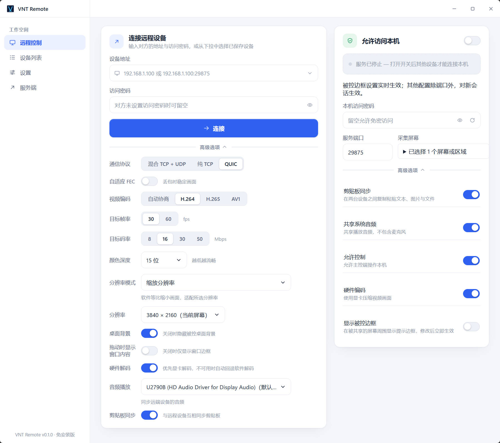

# VNT Remote

在另一台电脑上查看和操作 Windows 或 Mac，支持多屏、区域共享、系统声音，以及文字和图片复制粘贴。Windows 电脑之间还可以直接复制文件和文件夹。

两台电脑都需要运行 VNT Remote：被操作的电脑称为「被控端」，用来操作它的电脑称为「控制端」。同一台电脑也可以同时承担这两种角色。

[下载与更新](https://github.com/vnt-dev/vnt-remote/releases)

## 下载哪个版本？

| 你的电脑                              | 选择的版本                                          | 使用方式                                                                 |
| ------------------------------------- | --------------------------------------------------- | ------------------------------------------------------------------------ |
| Windows 10 / 11，64 位                | Windows 安装版                                      | 按安装向导安装，需要管理员授权；适合需要开机启动、登录或锁屏后访问的电脑 |
| Windows 10 / 11，64 位                | 文件名以 `-windows-x64-portable.exe` 结尾的免安装版 | 下载后直接运行；适合临时使用，在锁屏或系统授权界面暂停共享               |
| macOS 14 或以上，Apple 芯片（M 系列） | 文件名以 `-macos-arm64-portable.app.zip` 结尾的版本 | 解压后打开 `vnt-remote.app`                                              |

Windows 免安装版需要系统已安装 WebView2 Runtime。当前不支持 Intel Mac 和 Linux。两端请使用相同版本的应用。

### Mac 首次打开

如果系统阻止打开，请确认下载来源，然后在「系统设置 → 隐私与安全性」中按系统提示允许打开。当前 Mac 版本尚未经过 Apple 公证。

作为被控端时，还需按应用提示开启权限：

- **屏幕录制**：用于共享画面和系统声音。
- **辅助功能**：用于接收远程键盘、鼠标操作；只想共享画面时，可关闭「允许控制」。

授权后可能需要彻底退出并重新打开应用。只关闭窗口会驻留托盘，不等于退出。详细步骤见 [macOS 使用说明](docs/macos.md)。

## 第一次连接

先让两台电脑连接同一个局域网，例如同一个路由器下的 Wi-Fi 或有线网络。

### 1. 在被操作的电脑上开启共享

1. 打开 VNT Remote，在首页找到「允许访问本机」。
2. 选择要共享的显示器，也可以选择屏幕区域或多个显示器。
3. 设置「本机访问密码」，按需要开启「允许控制」「剪贴板同步」和「共享系统音频」。
4. 开启被控，并记下这台电脑的 IP 地址和端口；默认端口为 **29875**。

密码留空时允许免密访问，建议设置密码后再开启共享。关闭「允许控制」后，对方只能观看画面和接收声音，不能操作键鼠或同步剪贴板。

### 2. 在用来操作的电脑上发起连接

1. 打开首页的「连接远程设备」。
2. 输入被控电脑的地址，例如 `192.168.1.20:29875`；使用默认端口时也可以只填 IP。
3. 填写被控电脑的访问密码。初次使用可保留默认连接参数，视频编码选择「自动协商」。
4. 发起连接，在打开的远程窗口中操作对方电脑。

可以保存常用设备，方便下次连接；也可以保持一个远程窗口打开，再连接其他设备。

### 不在同一个局域网？

可使用「服务端」中的 VNT 连接功能。它需要配套的 VNT 服务端，不能仅凭对方的局域网 IP 跨网络连接。

1. 在两端分别添加服务端配置，使用服务提供者给出的订阅链接，或填写服务器地址、组编号和连接 ID。
2. 两端加入同一组，每台设备使用不同的连接 ID；如果设置通道加密密码，两端需保持一致。
3. 启用配置，等对方出现在「同组设备」列表中，再选择设备连接。

连接 ID 是 1～9 位数字，前导零会保留，例如 `001` 和 `0001` 是两个不同的 ID。通道加密密码与被控电脑的访问密码是两项独立设置。

## 常用操作

### 多屏和区域共享

被控端可选择多个显示器，或只共享指定区域。连接后，通过远程窗口的屏幕菜单切换画面，也可以将屏幕拆分为独立窗口。

关闭某个屏幕只停止接收该屏幕；关闭主远程窗口会结束整个连接。当前连接中已关闭的屏幕，需要重新连接才能打开。

### 复制文字、图片和文件

像平时一样，在一端复制，再到另一端粘贴即可。两端都需允许剪贴板同步，控制窗口也可单独关闭此功能。

- **文字和图片**：Windows 与 Mac 之间均可双向复制；粘贴图片的目标应用需要支持图片输入。
- **文件和文件夹**：仅支持 Windows 电脑之间复制。在另一端的资源管理器或桌面粘贴，会出现 Windows 原生复制窗口，可查看进度、处理重名文件或取消。小文件完成较快时可能不显示窗口。

复制文件只在粘贴时传输内容。传输期间请避免修改源文件；断线后需要重新粘贴，不支持断点续传。文件功能提供复制，不执行剪切删除。

### 听到远程电脑的声音

被控端开启「共享系统音频」，控制端在连接前的「音频播放」中选择播放设备。选择「不同步音频」可关闭这条连接的声音。

只传输电脑正在播放的系统声音，不采集麦克风。音频选项对新连接生效。两台电脑相互控制时，可关闭一个方向的音频，避免声音反复回传。

### 快捷键与全屏

Windows 控制端的鼠标位于远程画面内时，Win、Alt+Tab 等按键会发送到远程电脑；移出画面后恢复本机操作。按 **F11** 切换远程窗口全屏。

Mac 需先点击远程画面，键盘操作才会发送到对方；部分系统保留的快捷键仍由本机处理。Command、Option、Control 保持各自对应关系，不会自动互换。

连接到支持控制的 Windows 安装版被控端时，可用远程窗口中的 **Ctrl+Alt+Del** 按钮；免安装版和 Mac 被控端不提供此功能。

## 画面卡顿或连接不上？

| 遇到的问题                 | 可以先检查                                                                                                                  |
| -------------------------- | --------------------------------------------------------------------------------------------------------------------------- |
| 无法连接                   | 被控是否已开启、地址和端口是否正确、密码是否一致；局域网直连时确认两台电脑能互相访问，并检查防火墙是否允许连接              |
| 混合模式连接失败           | 尝试改用「纯 TCP」；部分网络会限制 UDP 通信                                                                                 |
| 画面卡顿或延迟较大         | 降低目标帧率、码率或画面分辨率，减少同时共享的屏幕；视频编码使用「自动协商」                                                |
| 网络丢包时画面不稳定       | 可尝试开启「自适应 FEC」，它会增加一些网络流量；纯 TCP 模式不使用此选项                                                     |
| 只能看，不能操作或粘贴     | 检查被控端的「允许控制」和两端剪贴板开关；Mac 还需辅助功能权限                                                              |
| Mac 没有画面或仍提示未授权 | 确认已给当前这份应用开启屏幕录制权限，再彻底退出并重新打开；详见 [权限排查](docs/macos.md#系统设置已开启但应用仍提示未授权) |
| Mac 无法复制文件           | 当前涉及 Mac 的连接支持文字和图片，不支持文件或文件夹复制                                                                   |
| 锁屏后画面暂停             | Windows 免安装版和 Mac 在锁屏时暂停共享；需要 Windows 登录、锁屏访问时使用安装版                                            |
| 没有声音                   | 检查被控端的系统音频开关、控制端选择的播放设备及两端音量，修改连接选项后重新连接                                            |

直连的「混合 TCP + UDP」和「纯 TCP」不加密画面及控制内容，适合在可信网络内使用；需要加密传输时可选择 QUIC，或使用 VNT 加密通道。

## 关闭、开机启动与更新

**关闭窗口**会让应用驻留在系统托盘或 Mac 菜单栏，正在进行的连接可继续运行。要完全停止应用，请从托盘菜单选择「退出」。Windows 安装版退出时也会停止本机被控和 Windows 服务。

**Windows 安装版**可在设置中开启「Windows 服务开机启动」。服务启动后会恢复保存的被控开关状态；需要开机后可连接时，请提前配置并开启被控。免安装版和 Mac 不提供被控服务开机启动。

**更新应用**：Windows 安装版可在设置中检查、下载和安装更新，安装时会关闭远程窗口，并可能需要管理员授权。Windows 免安装版和 Mac 请从 [发布页](https://github.com/vnt-dev/vnt-remote/releases) 下载对应版本，彻底退出应用后替换程序。

更多平台说明：[Windows 安装版与免安装版](docs/windows-service.md) · [macOS 使用说明](docs/macos.md)。
